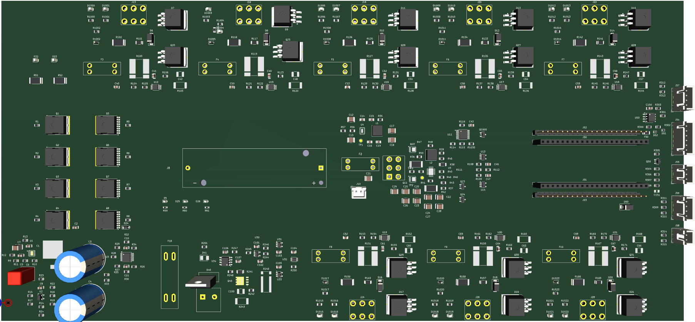
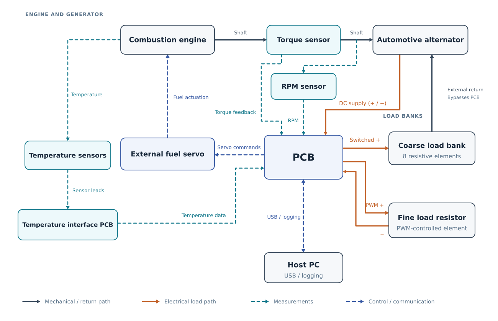
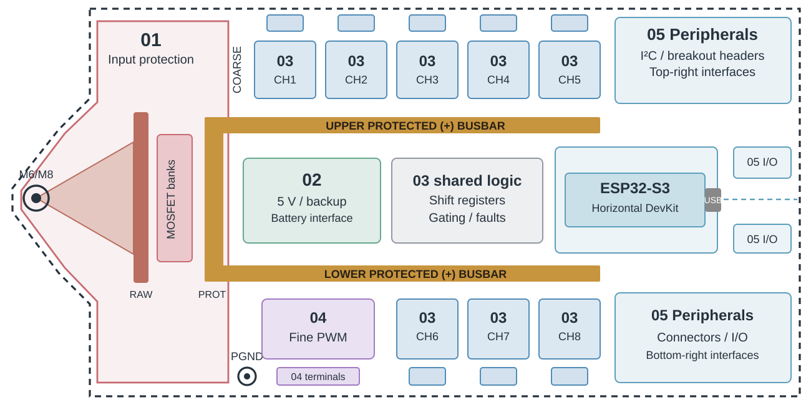
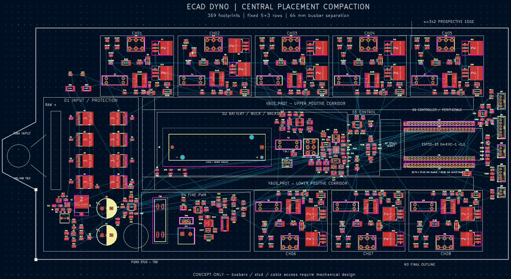
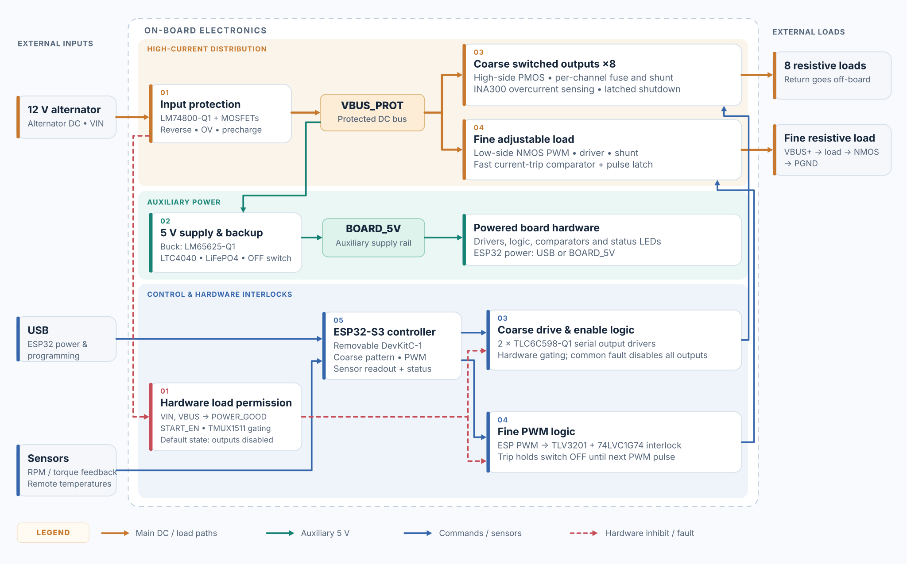

# ECAD Dyno
### Closed-Loop Small Engine Dynamometer Control Board

**Status:** In development — ECAD / PCB design phase  
**Tools:** KiCad 10  
**Fields:** Power Electronics · PCB Design · Embedded Systems · Control Systems · Instrumentation

## Overview

ECAD Dyno is a collaborative engineering project developing a custom electronic load, control, and measurement system for a small engine dynamometer.

An engine-driven automotive alternator provides the electrical load, regulated through eight independently controlled high-current channels and a separate PWM stage for fine adjustment.

An ESP32-S3 will coordinate electrical loading, engine fuel control through an external servo, and sensor acquisition. Torque and rotational speed measurements will allow direct calculation of mechanical shaft power.

The goal is to enable automated, closed-loop control of engine operating conditions and repeatable performance testing.

## Technical Specifications

| Parameter | Design target |
|---|---|
| Nominal electrical system | 12 V |
| Continuous load current | 150–160 A |
| Short-duration load current | Up to 200–250 A |
| Coarse load channels | 8 |
| Fine load regulation | MOSFET PWM |
| Engine power control | External fuel-control servo |
| Measurements | Torque, RPM, temperature and auxiliary sensors |
| Microcontroller | ESP32-S3 |
| Backup supply | LiFePO₄ battery |

*Performance specifications are design targets and have not yet been physically validated.*

## Key Engineering Features

- **High-side switching with external load returns:** Minimizes high-current return paths through the PCB.
- **High-current power distribution:** Copper busbar integration, distributed switching, and thermal considerations.
- **Independent hardware protection:** Overvoltage supervision, controlled startup, per-channel latched faults, and PWM cycle-by-cycle current limiting.
- **Coarse and fine load control:** Eight independently switched resistive channels complemented by a PWM-regulated stage.
- **Removable ESP32-S3:** Detachable development board with accessible GPIO breakout connections for troubleshooting and replacement.
- **Extended sensor interfaces:** Engine speed, torque, and temperature sensing, including long-distance I²C communication.
- **Closed-loop engine control:** Planned coordination of electrical loading and fuel delivery using sensor feedback.
- **Power management:** Integrated DC-DC conversion, LiFePO₄ charging, and backup power.

## PCB Layout Concept

The preliminary PCB floorplan illustrates the
distribution of functional subsystems, the eight
coarse load channels, and the proposed U-shaped
high-current busbar arrangement.

*Preliminary placement concept. Component positions,
routing, and mechanical dimensions remain subject
to revision.*

## PCB Design Progress

The PCB is currently in the component placement stage, with functional sections arranged around the high-current distribution architecture. Routing, busbar integration, and physical validation remain pending.

*Preliminary PCB placement in KiCad 10.*

## Board Functional Architecture

The PCB integrates five functional sections,
including power management, high-current load
switching, hardware protection, and embedded control.

The diagram illustrates the main power paths,
control signals, sensor interfaces, and hardware
fault-handling relationships.

## Development Progress

| Stage | Status |
|---|---|
| System architecture | Established |
| Schematic design | Initial design completed; under review |
| Component selection | Largely completed |
| Electrical rule checking | Passed |
| Circuit simulation | Planned |
| PCB placement | In progress |
| PCB routing | Pending |
| Manufacturing and assembly | Pending |
| Firmware development | Planned |
| Physical testing and validation | Pending |

## Technical Documentation

Selected technical documents and PCB visualizations will be published here as development progresses.

The documentation will cover system architecture, electrical design, engineering calculations, circuit simulation, PCB layout, and hardware validation.

## Project Team

ECAD_Dyno is developed collaboratively. Team member information and individual contributions will be added.

---

**Note:** This repository is a public project showcase. Detailed KiCad design files are maintained separately in a private development repository.
